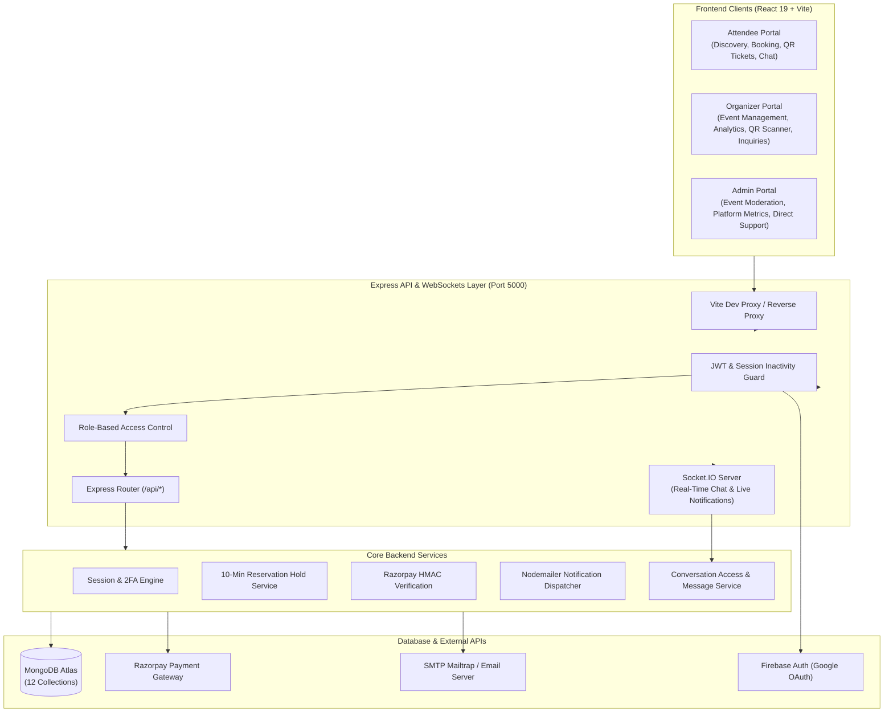

# UTSAV — Smart Event Management Platform

A production-grade, full-stack event ticketing, lifecycle moderation, and real-time communication platform built with **React 19**, **Vite**, **Node.js (ES Modules)**, **Express**, **MongoDB Atlas**, and **Socket.IO**.

UTSAV was engineered to solve real-world event coordination challenges: eliminating ticket overselling through atomic reservation holds, securing authentication with sliding session timeouts and TOTP-based 2FA, automating organizer approval workflows via Nodemailer, and enabling secure, private real-time messaging between attendees, organizers, and platform administrators.

---

## 🏗️ System Architecture



---

## 🌟 Key Engineering Highlights

### 1. Robust Authentication & Sliding Session Management
- **Token Security**: JSON Web Tokens (JWT) stored exclusively in `httpOnly`, `SameSite=lax` secure cookies, shielding tokens from client-side script inspection (XSS).
- **Server-Side Session Tracking**: Active sessions are tracked in a dedicated MongoDB `Session` collection storing client IP address, User-Agent, last active timestamp, and absolute expiry.
- **Sliding Inactivity & Absolute Ceilings**:
  - **Inactivity Timeout**: 30 minutes of idle inactivity automatically invalidates the session.
  - **Hard Lifetime Ceiling**: An unextendable 8-hour maximum lifetime forces re-authentication.
  - **Concurrent Session Controls**: Users can inspect and revoke other active sessions remotely from their account settings.
- **Two-Factor Authentication (2FA)**: Time-based One-Time Password (TOTP) algorithm using `otplib` with QR code provisioning and encrypted emergency recovery codes.
- **Google OAuth 2.0**: Seamless single-sign-on integration leveraging Firebase Client SDK with backend token verification.

### 2. Event Lifecycle & Moderation Pipeline
- **Draft & Submission**: Organizers draft events with venue details, pricing tiers, date schedules, category tags, and promotional artwork.
- **Admin Moderation**: Events require review by a Platform Administrator (`pending` $\to$ `approved` / `rejected`).
- **Automated Email Dispatch**: Upon admin approval or rejection, the backend dispatches transactional email notifications to the organizer's registered inbox via Nodemailer.
- **Publication Gate**: Events only become discoverable and eligible for ticketing and chat once published.

### 3. Inventory Reservation Holds & Checkout Engine
- **Race Condition Prevention**: Prevents ticket overselling during peak traffic through a **10-minute temporary reservation hold** (`holdExpiresAt`).
- **Atomic Checkout**: Spots are reserved temporarily while the attendee enters details and processes payment. If checkout is abandoned or expires, spots automatically release back to the available inventory pool.
- **Coupons & Discounts**: Real-time coupon validator supporting percentage and flat discounts, expiration windows, minimum order values, and maximum usage caps.
- **Razorpay Payments**: Complete checkout support for free tickets and paid tiers with server-side HMAC SHA-256 signature verification.
- **Cryptographic QR Tickets**: Confirmed bookings generate digital tickets with unique alphanumeric booking references and verifiable QR codes.
- **Gate Check-In Scanner**: Organizers can scan attendee QR codes directly from the browser camera at event entrance gates to check attendees in and prevent duplicate entries.

### 4. Real-Time Event Chat System (Socket.IO + REST Fallback)
- **Role-Partitioned Conversations**:
  1. `attendee_organizer`: Strictly 1-on-1 private messaging between a confirmed ticket holder and that specific event organizer. Ineligible, cancelled, or refunded users are barred by server-side authorization gates.
  2. `admin_organizer`: Private channel between platform admins and the event organizer for moderation queries and operational support.
- **Socket.IO Event Handlers**:
  - `join_conversation` / `leave_conversation`: Dynamic room subscription with server authorization checks.
  - `send_message` / `new_message`: Real-time delivery with acknowledgments and broadcast deduplication.
  - `typing_start` / `typing_stop` / `typing_status`: Real-time typing indicators with 3-second auto-debounce.
  - `mark_read` / `messages_read`: Live read receipts (`✓` sent, `✓✓` read) and unread counter badges.
- **Reliability & Security**:
  - **XSS Immunity**: Messages are strictly rendered as plain-text React nodes; untrusted HTML is never executed.
  - **Length Caps**: Enforced 2,000-character boundary on client composer and server endpoints.
  - **Reconnection Reconciliation**: State updater deduplicates messages by database `_id` when socket events and REST history overlap.
  - **HTTP Fallback**: Automatically falls back to authenticated REST endpoints if socket connection drops.

### 5. Notification & Feedback Systems
- **Live WebSocket Notifications**: Instant toast alerts when bookings confirm, events get approved, or messages arrive.
- **Persistent Notification Inbox**: Stored in MongoDB with read/unread tracking and badge count indicators.
- **Post-Event Reviews**: Verified attendees can rate events and leave feedback, feeding into aggregate organizer ratings.

---

## 📁 Repository Structure

```text
Event-Management-Platform/
├── backend/                              # Express & Node.js API (ES Modules)
│   ├── scripts/                          # Automated end-to-end test suites
│   │   ├── test_chat_frontend_integration.js # 42/42 tests for chat contracts
│   │   ├── test_event_chat_phase1.js     # Backend security & room isolation
│   │   ├── test_2fa_full_suite.js        # TOTP setup, verify, backup codes
│   │   ├── test_event_approval_email.js  # Moderation email dispatch tests
│   │   └── ...                           # Payment, session & coupon test suites
│   ├── src/
│   │   ├── config/                       # DB connection, Razorpay, Nodemailer, Firebase
│   │   ├── controllers/                  # Route business logic (auth, chat, events, etc.)
│   │   ├── middlewares/                  # Auth guards, role checks, error handlers, rate limiters
│   │   ├── models/                       # Mongoose schemas (12 data models)
│   │   ├── routes/                       # Express router definitions
│   │   ├── scripts/                      # Bootstrap scripts (admin setup, sample event seeder)
│   │   ├── services/                     # Socket.IO handlers, chat service, email service
│   │   ├── utils/                        # Token helpers, checkout hold calculator, coupons
│   │   ├── app.js                        # Express app configuration & middleware mounts
│   │   └── server.js                     # HTTP server startup with Socket.IO integration
│   ├── .env.example                      # Backend environment variable template
│   └── package.json
│
├── frontend/                             # React 19 + Vite Application
│   ├── src/
│   │   ├── api/                          # Clean API client modules (chat, events, auth, bookings)
│   │   ├── assets/                       # Static brand logos and SVGs
│   │   ├── components/                   # Modular, reusable UI components
│   │   │   ├── admin/                    # Admin moderation tabs, event inspection modals
│   │   │   ├── chat/                     # Conversation inbox, timeline, bubble, composer, drawer
│   │   │   ├── organizer/                # Event creation, attendee manager, chat tab
│   │   │   ├── Navbar.jsx                # Responsive navbar with live unread indicators
│   │   │   ├── BookingModal.jsx          # Ticket selector & reservation hold timer
│   │   │   └── ...                       # Ticket passes, 2FA settings, session timeout alert
│   │   ├── config/                       # Taxonomy, categories, motion animation variants
│   │   ├── context/                      # AuthContext, SocketContext, ChatContext, ThemeContext
│   │   ├── pages/                        # Route views (Attendee, Organizer, Admin dashboards)
│   │   ├── App.jsx                       # Main application shell & protected route definitions
│   │   ├── index.css                     # Global design tokens and responsive CSS
│   │   └── main.jsx                      # Vite React entry point
│   ├── .env.example                      # Frontend environment variable template
│   ├── vite.config.js                    # Vite config with /api reverse proxy
│   └── package.json
│
├── package.json                          # Root orchestration scripts
└── README.md                             # Comprehensive technical documentation
```

---

## 🗄️ Database Models (Mongoose)

| Model | Collection | Primary Responsibility |
| :--- | :--- | :--- |
| **`User`** | `users` | User credentials, role (`attendee`, `organizer`, `admin`), profile, 2FA secret, backup recovery codes. |
| **`Session`** | `sessions` | Server-managed sessions, client IP, User-Agent, sliding inactivity expiry (`expiresAt`), absolute lifetime. |
| **`Event`** | `events` | Event title, dates, venues, categories, ticket pricing, status (`pending`, `approved`, `published`, `rejected`), organizer reference. |
| **`Booking`** | `bookings` | Ticket quantity, total amount, booking reference, payment status, reservation hold timer (`holdExpiresAt`), check-in status. |
| **`Ticket`** | `tickets` | Digital ticket item, unique alphanumeric code, encrypted QR data payload, validation timestamp. |
| **`Conversation`** | `conversations` | Chat channel metadata, type (`attendee_organizer` vs `admin_organizer`), participant references, unread counters. |
| **`Message`** | `messages` | Message payload, sender reference, plain text (max 2,000 chars), read receipt array (`readBy`). |
| **`Notification`** | `notifications` | In-app alerts, target user, notification type, read status, redirect link. |
| **`Coupon`** | `coupons` | Promo codes, discount percentage / flat deduction, validity date range, usage limits. |
| **`CouponRedemption`** | `couponredemptions` | Audit log tracking user redemption of specific discount codes. |
| **`Review`** | `reviews` | Event star ratings (1–5) and written feedback from verified attendees. |
| **`AuditLog`** | `auditlogs` | Administrative action audit trails (approvals, rejections, role elevations, suspensions). |

---

## 🔌 API & Real-Time Specifications

### Core REST Endpoints

#### Authentication & Sessions (`/api/auth`)
- `POST /api/auth/register` — Register a new account (`attendee` or `organizer`).
- `POST /api/auth/login` — Authenticate credentials; sets `token` HTTP-only cookie.
- `POST /api/auth/logout` — Revoke active session and clear cookie.
- `GET /api/auth/me` — Retrieve authenticated user profile and permissions.
- `POST /api/auth/2fa/setup` — Generate TOTP secret and QR code.
- `POST /api/auth/2fa/verify` — Enable 2FA with 6-digit TOTP code.
- `GET /api/auth/sessions` — List all active login sessions with IP/device info.
- `DELETE /api/auth/sessions/:sessionId` — Remotely terminate a specific session.

#### Events & Discovery (`/api/events`)
- `GET /api/events` — Query published events with search, city, category, and date filters.
- `GET /api/events/:id` — Detailed event metadata and ticketing tiers.
- `POST /api/events` — Create a new event draft (Organizer only).
- `PUT /api/events/:id` — Update event details (Organizer ownership verified).
- `DELETE /api/events/:id` — Cancel or remove event.

#### Admin Moderation (`/api/admin`)
- `GET /api/admin/events` — View moderation queue (`pending`, `published`, `rejected`).
- `PUT /api/admin/events/:id/approve` — Approve & publish event; triggers Nodemailer notification to organizer.
- `PUT /api/admin/events/:id/reject` — Reject event with moderation feedback reason.
- `GET /api/admin/analytics` — Platform-wide revenue, tickets booked, and active user metrics.

#### Bookings & Ticketing (`/api/bookings`)
- `POST /api/bookings/hold` — Atomically reserve ticket capacity for 10 minutes.
- `POST /api/bookings/confirm` — Finalize booking and issue QR tickets upon payment success.
- `GET /api/bookings/my-bookings` — Query attendee ticket history.
- `POST /api/bookings/:id/cancel` — Cancel booking and initiate refund workflow.
- `POST /api/bookings/check-in` — Validate ticket QR code at event gate (Organizer only).

#### Real-Time Chat (`/api/chat`)
- `GET /api/chat/conversations` — Retrieve accessible conversations with computed unread counts.
- `POST /api/chat/conversations` — Atomically retrieve or create a conversation channel (access-gated).
- `GET /api/chat/conversations/:id/messages` — Paginated message history (`before=<isoDate>&limit=50`).
- `POST /api/chat/conversations/:id/messages` — Fallback REST message dispatch.
- `PUT /api/chat/conversations/:id/read` — Mark conversation as read and reset unread counters.
- `GET /api/chat/unread-count` — Query aggregate unread messages badge count.

---

### Socket.IO Event Contracts

| Event | Direction | Payload | Description |
| :--- | :--- | :--- | :--- |
| `join_conversation` | Client $\to$ Server | `{ conversationId }` | Validates session authorization; subscribes client socket to room `conversation:<id>`. |
| `leave_conversation` | Client $\to$ Server | `{ conversationId }` | Unsubscribes client socket from room when navigating away. |
| `send_message` | Client $\to$ Server | `{ conversationId, text }` | Dispatches message; server enforces token sender identity, stores message, returns ack. |
| `new_message` | Server $\to$ Client | `{ conversationId, message }` | Broadcast to room participants; client deduplicates by `message._id`. |
| `typing_start` | Client $\to$ Server | `{ conversationId }` | Broadcasts user typing status to room. |
| `typing_stop` | Client $\to$ Server | `{ conversationId }` | Clears typing status upon pause or submission. |
| `typing_status` | Server $\to$ Client | `{ conversationId, userId, userName, isTyping }` | Renders animated typing indicator dots in active thread. |
| `mark_read` | Client $\to$ Server | `{ conversationId }` | Clears unread counts and records read timestamps. |
| `messages_read` | Server $\to$ Client | `{ conversationId, userId, readAt }` | Updates read status ticks (`✓✓`) in real time across clients. |
| `chat_notification` | Server $\to$ Client | `{ conversationId, eventId, senderName, text }` | Increments unread counter badge when message arrives out-of-focus. |
| `chat_error` | Server $\to$ Client | `{ success: false, error }` | Transmits room join or submission authorization rejections. |

---

## ⚙️ Local Development Setup

### 1. Prerequisites
- **Node.js**: `v18.0.0+` (Tested on `v20` and `v24`)
- **npm**: `v9.0.0+`
- **MongoDB Atlas** or local MongoDB instance (`v6.0+`)

### 2. Clone Repository
```bash
git clone https://github.com/lohith2605/Event-Management-Platform-.git
cd Event-Management-Platform-
```

### 3. Install All Dependencies
Install dependencies for both `backend` and `frontend` using the root workspace script:
```bash
npm run install:all
```

### 4. Configure Environment Variables

#### Backend (`backend/.env`)
Create `backend/.env` based on `backend/.env.example`:
```env
PORT=5000
NODE_ENV=development
MONGODB_URI=mongodb+srv://<username>:<password>@cluster0.mongodb.net/utsav?retryWrites=true&w=majority
CORS_ORIGIN=http://localhost:5173
FRONTEND_URL=http://localhost:5173

# JWT & Session Secrets
JWT_SECRET=utsav_super_secure_jwt_secret_key_2026_events_platform
JWT_EXPIRE=8h
COOKIE_EXPIRE=7

# Sliding Session Timing (Milliseconds)
SESSION_INACTIVITY_TIMEOUT_MS=1800000       # 30 Minutes
SESSION_ABSOLUTE_LIFETIME_MS=28800000        # 8 Hours
SESSION_WARNING_BEFORE_EXPIRY_MS=120000      # 2 Minutes

# Initial Platform Admin Credentials
ADMIN_NAME=UTSAV Platform Administrator
ADMIN_EMAIL=admin@utsav.test
ADMIN_PASSWORD=AdminSecurePassword123!
REQUIRE_ADMIN_2FA=false

# SMTP Mailtrap Configuration (Email Notifications)
SMTP_HOST=smtp.mailtrap.io
SMTP_PORT=2525
SMTP_USER=your_mailtrap_user
SMTP_PASS=your_mailtrap_password
FROM_EMAIL=noreply@utsav.in
FROM_NAME=UTSAV Events

# Razorpay Sandbox (Optional for paid ticket testing)
RAZORPAY_KEY_ID=rzp_test_sample_key
RAZORPAY_KEY_SECRET=sample_secret_key
```

#### Frontend (`frontend/.env`)
Create `frontend/.env` (optional, as Vite proxy forwards `/api` automatically):
```env
VITE_API_BASE_URL=http://localhost:5000
```

### 5. Bootstrap Database & Seed Sample Events
Run the backend bootstrap utilities to initialize collections, provision the Platform Admin account, and seed test events:
```bash
# Provision initial platform admin account
npm --prefix backend run setup:admin

# Seed categorized sample events (Technology, Music, Cultural, Workshops)
npm --prefix backend run seed:events
```

### 6. Start Development Servers

Run both servers concurrently:
```bash
# Terminal 1: Backend API & Socket Server (port 5000 with watch mode)
npm run dev:backend

# Terminal 2: Vite React Frontend (port 5173 with HMR)
npm run dev:frontend
```

Open your browser at **`http://localhost:5173`**.

---

## 🧪 Testing & Validation

The codebase includes comprehensive integration test suites that spin up mock HTTP/Socket servers against real MongoDB Atlas fixtures to guarantee zero regressions.

### Run Automated Integration Tests

```bash
# Real-Time Chat Phase 2 Frontend Contract Suite (42/42 Tests)
node backend/scripts/test_chat_frontend_integration.js

# Real-Time Chat Phase 1 Backend Security & Room Isolation (40/40 Tests)
node backend/scripts/test_event_chat_phase1.js

# Two-Factor Authentication Full Flow (TOTP, Secret Generation, Backup Codes)
node backend/scripts/test_2fa_full_suite.js

# Event Approval & Nodemailer Email Dispatch Tests
node backend/scripts/test_event_approval_email.js

# Session Management & Sliding Timeout Revocation
node backend/scripts/test_session_management.js

# Ticket Checkout Hold & Razorpay Verification
node backend/scripts/test_cancellation_refund.js
```

### Run Static Analysis & Production Build

```bash
# Frontend Linter (oxlint)
npm --prefix frontend run lint

# Frontend Production Compilation (vite build)
npm run build:frontend
```

---

## 🛡️ Security Implementation Details

1. **Untrusted HTML Prevention**: Chat message text and user input are strictly mapped into plain-text React elements (`<span>{message.text}</span>`). No `dangerouslySetInnerHTML` is used in user-generated content paths.
2. **Strict Identity Enforcement**: Sender identifiers, roles, and timestamps are generated server-side from verified JWT claims. Client payload attempts to forge `senderId` or `senderRole` are ignored.
3. **Double-Booking Shield**: Ticket reservation holds use atomic database queries (`$inc` and status checks) to ensure inventory cannot be oversold under concurrent traffic.
4. **CSRF & Cookie Protection**: Session authentication cookies use `HttpOnly`, `SameSite=Lax`, and `Secure` flags in production to guard against credential theft.
5. **Rate Limiting**: Critical endpoints (`/api/auth/login`, `/api/auth/register`, `/api/chat`) are protected by `express-rate-limit` to mitigate brute-force and spam attacks.

---

## 👥 User Roles & Default Test Access

| Role | Scope | Access Points |
| :--- | :--- | :--- |
| **Attendee** | Browse events, book tickets, manage QR passes, review attended events, message organizers for booked events. | `/events`, `/attendee/bookings`, `/attendee/messages` |
| **Organizer** | Create and publish events, inspect sales analytics, scan ticket QR codes at gate, chat with attendees and admin. | `/organizer`, `/organizer/events`, `/organizer/messages` |
| **Platform Admin** | Review and approve/reject pending events, monitor platform health, direct support chat with organizers. | `/admin`, `/admin/events`, `/admin/chat` |

---

## 📄 License

This project is licensed under the [MIT License](LICENSE). Built for educational and enterprise event management demonstration.
